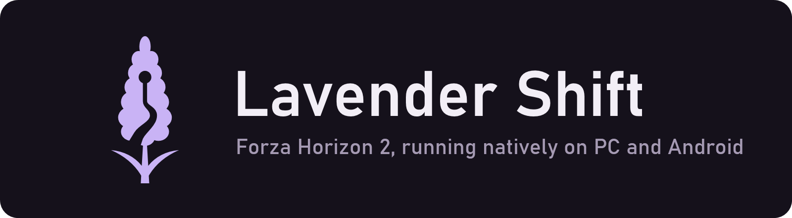

# Lavender Shift

  

  <b>Play the Xbox 360 version of <i>Forza Horizon 2</i> natively on your Windows PC, and on Android.</b> 
  You bring your own copy of the game; the launcher sets everything else up.

  <a href="https://github.com/arcanite24/lavender-shift/releases/latest"><b>Download the launcher</b></a>
  ·
  <a href="#how-to-play">How to play</a>
  ·
  <a href="#playing-on-android">Android</a>
  ·
  <a href="#questions">Questions</a>

## What you need

- **Your own copy of the game:** the Forza Horizon 2 **USA** disc image
  (`.iso`) and **title update v2**. They don't come with Lavender Shift,
  and we can't tell you where to get them.
- **A Windows 10 or 11 PC** (64-bit) with:
  - a processor from 2013 or newer (Intel Haswell, AMD Ryzen or later);
  - a graphics card that supports Vulkan (almost any from the last ten
    years);
  - about **20 GB** of free space.

## How to play

1. **Download** `LavenderShift-<version>-windows-x64.zip` from the
   [latest release](https://github.com/arcanite24/lavender-shift/releases/latest).
2. **Extract** it to a folder with a short path, such as
   `C:\Games\LavenderShift`.
3. **Open** `LavenderShiftLauncher.exe`.
4. **Choose** your disc image and the title update, then press **Set up**.
5. **Wait** while the launcher builds the game on your PC. The first time
   takes 15 minutes to an hour. If it stops, press **Set up** again and
   it carries on where it left off.
6. **Press Play.** Press **F6** in game for the settings.

Your saves and settings are kept in the `user` folder next to the
launcher.

**Updating:** extract the new release into the same folder and press
**Set up** again. It only rebuilds what changed, and your saves stay.

## Playing on Android

When the game works on your PC, the launcher can put it on your phone or
tablet too.

**Your device needs:** Android 13 or newer, a recent 64-bit processor and
graphics with Vulkan 1.3, and about 9 GB of free space (an SD card works).
It runs at 60 fps on a Snapdragon 8 Gen 2 handheld.

1. In the launcher, click **Android** at the bottom.
2. Press **Build APK**. The first build takes 15 to 45 minutes and needs
   about 15 GB on your PC. You'll be asked to accept Google's Android
   licence once.
3. Then pick one:
   - **Share on Wi-Fi:** scan the QR code with your device, install the
     app from the page that opens, open **Lavender Shift** and type the
     code shown on your PC. The game files copy across your network.
   - **Install over USB:** connect your device with USB debugging turned
     on.
4. Open **Lavender Shift** on your device and play.

More detail is in the [Android guide](docs/ANDROID.md).

## Questions

**Is the game included?** No. You need your own disc image and title
update, and nothing from the game is in this project. Setup reads your
files on your PC and never uploads them.

**Which version of the game works?** Only the USA disc with title update
v2. The launcher checks your files and tells you if they don't match.

**Something went wrong.** Press **Set up** again first; it picks up where
it stopped. If it keeps failing,
[open an issue](https://github.com/arcanite24/lavender-shift/issues) and
include what the launcher says.

**Can I play with a controller?** Yes, and it's the best way to play. On PC,
keyboard and mouse work too; on Android, there are touch controls on screen.

---

Lavender Shift is a fan project. It isn't affiliated with Microsoft,
Xbox Game Studios or Playground Games. It's built on
[ShiftGlue](https://github.com/arcanite24/shiftglue-sdk), the same
technology as [Pinyon Shift](https://github.com/arcanite24/pinyon-shift)
(Forza Horizon 1).

Developers: see [Building from a checkout](docs/BUILDING.md) and
[docs/LEGAL.md](docs/LEGAL.md).
